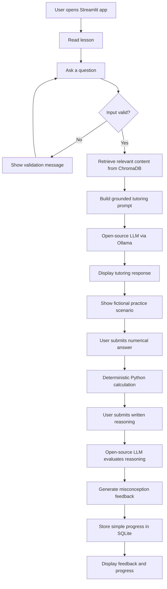

# TradeTutor AI — CAP 942 Implementation Plan

> **Purpose of this document:** This is a learning roadmap for building TradeTutor AI. It intentionally does **not** contain a complete working application. Each milestone should be completed, tested, and understood before moving to the next one.

---

## 1. Project Title

**TradeTutor AI**  
*An educational AI tutoring application for learning foundational trading risk-management concepts through lessons, grounded Q&A, practice scenarios, deterministic calculations, reasoning feedback, and progress tracking.*

---

## 2. Project Summary

TradeTutor AI is a small, functional AI learning application that helps beginner and aspiring traders understand foundational risk-management concepts. The MVP will focus on a limited set of lessons and practice activities rather than trying to teach all of trading. Users will read a lesson, ask questions, receive an answer generated by an open-source LLM, complete a fictional practice scenario, perform a deterministic numerical calculation, explain their reasoning, receive educational feedback, and have basic progress stored locally. The application will use Python and Streamlit, with an open-source LLM running locally through Ollama. ChromaDB-based retrieval will be added only after the smallest LLM-powered workflow is working.

**Value proposition:** TradeTutor AI gives beginner traders a safer, structured way to practice risk-management thinking with AI-supported explanations instead of relying on scattered or ungrounded trading content.

---

## 3. Problem Statement

### Problem Being Addressed

Beginner traders often encounter fragmented online information, unsupported claims, and passive learning resources that do not verify whether they actually understand risk-management concepts. Important ideas such as position sizing and risk/reward are often learned as formulas without enough guided practice or feedback.

### Why It Matters

Poor understanding of risk can lead learners to overestimate confidence, misunderstand losses, or make decisions without a repeatable reasoning process. An educational tutoring application can create a structured learning loop: learn, ask, practice, explain, receive feedback, and try again.

### Intended Users

**Primary users:** Beginner and aspiring traders who want a structured educational environment for learning foundational risk-management concepts.

**Secondary users:** Self-directed learners who want guided practice, AI-supported explanations, and feedback on their understanding.

**Not intended for:** Users seeking personalized financial advice, specific security recommendations, guaranteed returns, advanced trading strategies, or automated trading.

---

## 4. Capstone Requirement Alignment

The CAP 942 guidelines require a **small but functional AI application** using an existing open-source LLM. The application must accept user input, produce LLM-generated output, run end-to-end, demonstrate workflow design and prompt engineering, use no paid APIs, and include clear documentation. If retrieval or memory is used, a database is appropriate.

| Capstone Requirement | How TradeTutor AI Will Meet It | Evidence / Deliverable |
|---|---|---|
| Solve a clear problem | Teach beginner traders foundational risk-management concepts in a structured learning flow | Problem statement in README and presentation |
| Use at least one open-source LLM | Use one local instruct/chat model through Ollama | Model name in `pyproject.toml`/docs plus successful local demo |
| Accept user input | Accept learner questions, calculation answers, and written reasoning | Streamlit input widgets during demo |
| Produce LLM-generated output | Generate grounded tutoring explanations and reasoning feedback | Visible model response in the UI |
| Run in an approved format | Build as a Python Streamlit web app | `streamlit run ...` instructions and live demo |
| Run without paid APIs | Use local Ollama model and local/open-source libraries | README setup; no paid API keys required |
| Demonstrate input → processing → output | User question → prompt/retrieval → LLM → displayed answer | Mermaid workflow and live demonstration |
| Demonstrate prompt engineering | Create a deliberate tutoring system prompt and structured response expectations | Prompt template documented and tested |
| Use database when retrieval/memory is included | Use ChromaDB for retrieval; SQLite only for simple progress storage | Local database files created at runtime; architecture documentation |
| Use realistic inputs | Create fictional risk-management questions and practice scenarios | Test cases and demo examples |
| Clear code structure/readability | Separate UI, LLM, retrieval, calculations, and persistence responsibilities | Organized repository and comments/docstrings |
| Clear documentation | Maintain README, implementation plan, workflow diagram, setup steps, and source documentation | GitHub repository |
| Final presentation | Prepare a 5–10 minute presentation with demo, workflow, tools, challenges, lessons, next steps | Slide deck or supporting presentation document |
| GitHub submission | Push runnable project with instructions | GitHub link submitted through Canvas |
| No ML/DL training required | Use a pretrained model only | No training code or custom neural network |
| Keep scope small | Complete one coherent risk-management learning module before optional enhancements | MVP acceptance checklist |

> **Rubric note:** The supplied CAP 942 document states a total of **600 points**, but the visible rubric categories in that document list Proposal (60), Functional Application (210), and Documentation & Presentation (30), which total 300. This plan aligns with every rubric criterion explicitly shown in the supplied document. Before final submission, verify whether your instructor has provided a separate or expanded rubric covering the remaining points.

---

## 5. Project Scope

### Required MVP Features

The MVP should be small enough to complete and test confidently.

1. **One focused learning module:** Risk Management Fundamentals.
2. **At least one structured lesson** presented in Streamlit.
3. **Learner Q&A input** related to the lesson.
4. **One open-source LLM** running locally through Ollama.
5. **LLM-generated tutoring response** shown to the learner.
6. **One fictional practice scenario.**
7. **One or two deterministic calculations**, such as:
   - risk/reward ratio;
   - position sizing.
8. **Written reasoning input** from the learner.
9. **AI-assisted educational feedback** on the learner's explanation.
10. **Basic local progress persistence** in SQLite, if time permits after the core workflow works.
11. **RAG retrieval with ChromaDB** after the basic LLM call works.
12. **Tests** for deterministic calculations and core application behavior.
13. **Documentation and runnable setup instructions.**

### Outside the Initial Scope

Do not build these before the MVP is complete:

- live market prices;
- brokerage integration;
- real-money trading;
- stock or security recommendations;
- chart technical analysis;
- fundamental analysis;
- options strategies;
- backtesting;
- user authentication;
- cloud hosting that requires paid services;
- multi-agent systems;
- multiple LLMs;
- voice interfaces;
- complex dashboards;
- mobile apps;
- multi-user accounts;
- advanced gamification.

### Optional Enhancements — Only After MVP Works

- Additional risk-management lessons.
- More practice scenarios.
- Learning-progress visualization.
- Additional misconception categories.
- Adaptive remediation.
- More polished Streamlit styling.
- Exportable progress summary.
- Additional local model comparison.
- React/FastAPI redesign as a future version, not as a CAP 942 dependency.

---

## 6. Recommended Technology Stack

| Area | Recommendation | Why It Fits |
|---|---|---|
| Language | Python 3.11+ | CAP 942 recommends Python; integrates well with the chosen AI stack |
| Project management | `uv` | Fast environment and dependency management; keeps dependencies in `pyproject.toml` |
| UI | Streamlit | Approved in the capstone and allows rapid development of a usable AI interface |
| Open-source LLM | A small instruct model available through Ollama | Meets the open-source/local-model requirement without a paid API |
| Model runner | Ollama | Beginner-friendly local model execution and explicitly included in CAP 942 guidance |
| Smaller-model alternative | A 3B-class instruct model | Better option when RAM/CPU limits make a larger model too slow |
| Embeddings | SentenceTransformers | Local semantic embeddings for RAG without API costs |
| Vector database | ChromaDB | Local, lightweight, and recommended in the capstone guidance |
| Progress database | SQLite | Simple local persistence; sufficient for single-user MVP |
| Validation | Pydantic | Makes structured model/application data easier to validate |
| Testing | pytest | Simple, common Python testing framework |
| Version control | Git + GitHub | Required for project submission and documentation |
| Editor | VS Code | Suitable for Python, Git, terminal, and Markdown work |

### Model Recommendation

Do **not** make the project depend on a large model. Start by proving that the workflow works with a small instruction-tuned model supported by your computer. Once the project is functional, you may compare a larger model if your hardware can run it comfortably.

### Hardware Considerations

The CAP 942 guidelines state that local-model requirements depend on the application, suggest **16 GB RAM minimum and 32 GB recommended**, and recommend **3B–7B models** for best performance. If local execution is too slow, the guidelines also allow free alternatives such as Colab or Hugging Face inference options.

For this MVP:

- Start small.
- Favor a 3B-class model if response speed is poor.
- Do not optimize for the "smartest" model before the workflow works.
- Test response latency on your actual machine early.
- Record any hardware limitation as part of your presentation's "Challenges & Lessons Learned."

### Why Streamlit Instead of React for the MVP

React could create a more flexible frontend, but it would also add a separate frontend application, API integration, routing/state concerns, and additional debugging work. Streamlit keeps the project Python-centered so the capstone time can be spent learning LLM execution, prompting, retrieval, testing, and AI workflow design.

---

## 7. Application Workflow

### Complete MVP Flow

1. User opens the Streamlit application.
2. User selects or reads a Risk Management Fundamentals lesson.
3. User enters a question.
4. The application validates the question.
5. **First implementation:** the question and tutoring instructions are sent directly to the local open-source LLM.
6. **After the basic LLM workflow works:** the application embeds the question and retrieves relevant knowledge chunks from ChromaDB.
7. Retrieved content is inserted into the tutoring prompt.
8. The **open-source LLM** generates an educational answer grounded in the retrieved material.
9. The user receives a fictional practice scenario.
10. The user submits a numerical answer.
11. A deterministic Python function calculates or validates the expected result.
12. The user explains the reasoning behind the answer.
13. The **open-source LLM** evaluates the written explanation against a small rubric and generates educational feedback.
14. The application stores a simple progress record in SQLite.
15. The UI displays result, explanation feedback, and progress status.
16. Errors are caught and shown as understandable messages rather than raw stack traces.

### Mermaid Workflow Diagram



### Where the LLM Is Used

The LLM should have **two clear jobs**:

1. **Tutoring:** Explain lesson-related concepts using retrieved educational context.
2. **Reasoning feedback:** Evaluate the learner's written explanation against a defined educational rubric.

The LLM should **not** be responsible for exact arithmetic. Numerical validation should remain deterministic Python logic.

---

## 8. Application Architecture

### Major Components

**1. Streamlit UI Layer**  
Displays lesson content, collects questions, displays AI answers, presents practice scenarios, collects numerical and written responses, and shows feedback.

**2. Input Validation Layer**  
Checks for empty input, unreasonable length, missing required fields, and incorrect numeric formats before passing data deeper into the application.

**3. LLM Service**  
Contains the logic for communicating with the local model runner. It should not contain Streamlit-specific code.

**4. Prompt Service**  
Builds the system and user prompts. Keeping prompts separate makes them easier to test and revise.

**5. Retrieval Service**  
Creates embeddings, queries ChromaDB, and returns relevant lesson/knowledge chunks.

**6. Calculation Service**  
Contains deterministic functions for risk/reward and position-sizing calculations.

**7. Feedback / Evaluation Service**  
Builds the reasoning-evaluation prompt, receives the LLM response, checks its expected structure, and returns educational feedback.

**8. Database Service**  
Creates, stores, and retrieves simple progress records using SQLite.

### Information Flow

```text
Streamlit UI
    ↓
Validation
    ↓
Business/service function
    ├── Retrieval → ChromaDB
    ├── Prompt creation → Ollama LLM
    ├── Numerical calculation → Python
    ├── Progress write → SQLite
    ↓
Validated result
    ↓
Streamlit display
```

### Error Handling

Handle errors at the layer that understands them:

- **Input errors:** validate before model calls.
- **Ollama connection errors:** LLM service catches connection/runtime issues and returns a useful application-level error.
- **Retrieval errors:** retrieval service catches missing collection/document problems.
- **Calculation errors:** deterministic functions reject invalid values such as zero risk per share or negative account size.
- **Database errors:** database service handles connection and write failures.
- **UI layer:** catches known application errors and displays simple user-friendly messages.

Avoid `except Exception: pass`. Errors should either be handled meaningfully or surfaced during development.

---

## 9. Proposed Project Structure

```text
tradetutor-ai/
├── app/
│   ├── __init__.py
│   ├── ui/
│   │   └── home.py
│   ├── services/
│   │   ├── llm_service.py
│   │   ├── prompt_service.py
│   │   └── feedback_service.py
│   ├── rag/
│   │   ├── ingest.py
│   │   └── retriever.py
│   ├── calculations/
│   │   ├── risk_reward.py
│   │   └── position_sizing.py
│   ├── database/
│   │   └── progress_repository.py
│   └── models/
│       └── schemas.py
├── data/
│   ├── lessons/
│   │   └── risk_management.md
│   └── knowledge/
│       └── sources_go_here.md
├── tests/
│   ├── test_risk_reward.py
│   ├── test_position_sizing.py
│   └── test_validation.py
├── docs/
│   ├── implementation_plan.md
│   └── workflow.md
├── .gitignore
├── pyproject.toml
└── README.md
```

### Purpose of Each Area

- `app/ui/`: Streamlit presentation only.
- `app/services/`: reusable application/AI logic.
- `app/rag/`: document ingestion and retrieval.
- `app/calculations/`: deterministic mathematics.
- `app/database/`: SQLite access.
- `app/models/`: Pydantic schemas or shared structured data.
- `data/lessons/`: content users directly study.
- `data/knowledge/`: source material used by retrieval.
- `tests/`: automated tests.
- `docs/`: architecture, workflow, learning plan, and final supporting documentation.
- `pyproject.toml`: Python project metadata and dependencies.
- `README.md`: setup, purpose, usage, stack, and submission-facing documentation.

Do not create every file immediately. Add files as milestones require them.

---

# 10. Step-by-Step Development Milestones

## Milestone 0 — Understand the Requirements and Freeze the MVP

### Learning Objective
Translate a broad product idea into a capstone-sized system you can explain.

### Concepts to Review
- MVP
- functional requirement
- non-functional requirement
- acceptance criteria
- end-to-end workflow

### Development Tasks
- Re-read CAP 942 requirements.
- Review your README and this plan.
- Write the exact MVP workflow in your own words.
- Choose one lesson to implement first.
- Define one practice calculation.
- Identify where the LLM is necessary and where deterministic Python is better.

### Small Coding Exercise
No application code yet. Create a tiny Python function on scratch paper or in a temporary file that takes two numbers and returns their ratio. Explain what inputs, output, and invalid cases mean.

### Testing Checkpoint
Ask yourself whether you can explain the MVP in 30 seconds without reading the README.

### Acceptance Criteria
You can state:
- the problem;
- the user;
- the one learning module;
- where the LLM is used;
- where Python calculations are used;
- what success looks like.

### Common Mistakes
- Adding technical analysis, live data, or multiple models too early.
- Treating every idea as an MVP feature.
- Starting UI work before the core workflow is understood.

### What I Need to Build Myself
Your final written MVP definition and the actual lesson/practice choice.

### How I Will Know It Works
You can explain the project clearly to another person and they can repeat the workflow back accurately.

---

## Milestone 1 — Initialize the Python Project with `uv`

### Learning Objective
Understand how a Python project and its dependencies are managed.

### Concepts to Review
- virtual environment;
- dependency;
- `pyproject.toml`;
- package vs module;
- source control.

### Development Tasks
- Confirm Python version.
- Run `uv init` yourself.
- Inspect every new file created.
- Create/sync the environment.
- Add only the first dependencies you actually need.
- Confirm `.venv/` is ignored by Git.
- Commit this checkpoint separately.

### Small Coding Exercise
Create a temporary script that prints your Python version using the standard library.

### Testing Checkpoint
Run a simple Python command using the `uv`-managed environment.

### Acceptance Criteria
- `pyproject.toml` exists.
- You can explain what it controls.
- The environment can run Python.
- Git is not tracking `.venv`.

### Common Mistakes
- Installing many packages before knowing why they are needed.
- Committing the virtual environment.
- Copying setup commands without understanding the files they change.

### What I Need to Build Myself
The environment and dependency setup.

### How I Will Know It Works
A clean clone can reproduce the environment from documented instructions.

**STOP AND REVIEW:** Do not start Streamlit or RAG until you can explain `uv`, the environment, and `pyproject.toml`.

---

## Milestone 2 — Run One Open-Source LLM Locally

### Learning Objective
Understand the smallest possible LLM interaction before adding UI or retrieval.

### Concepts to Review
- pretrained model;
- model runner;
- system prompt;
- user prompt;
- inference;
- temperature;
- context window.

### Development Tasks
- Install/configure Ollama separately.
- Choose one small instruction model.
- Run it from the command line first.
- Send one trading-education question manually.
- Then call the model from a tiny Python experiment.
- Record approximate response time.

### Small Coding Exercise
Write a tiny Python function that receives a string and prepares a request body for a local model endpoint. Do not connect it to Streamlit.

### Testing Checkpoint
Test:
- a normal educational question;
- an empty question;
- an unrelated question;
- a request for direct financial advice.

### Acceptance Criteria
The local model responds without a paid API and you understand how Python sends input and receives output.

### Common Mistakes
- Choosing a model too large for the machine.
- Treating the first model answer as automatically correct.
- Hiding all model logic inside UI code.

### What I Need to Build Myself
The first local-model experiment and the final choice of model.

### How I Will Know It Works
You can call the model from Python and print a response without Streamlit.

**STOP AND REVIEW:** This is already enough to satisfy the core "user input → LLM → output" concept at a technical level. Preserve this checkpoint before adding complexity.

---

## Milestone 3 — Create the First Deterministic Calculation

### Learning Objective
Separate tasks that require generative AI from tasks that should be exact and testable.

### Concepts to Review
- pure functions;
- parameters;
- return values;
- validation;
- boundary cases;
- unit tests.

### Development Tasks
- Choose risk/reward or position sizing as the first calculation.
- Write the formula yourself.
- Implement it as a small reusable function.
- Decide how invalid inputs should behave.
- Add unit tests.
